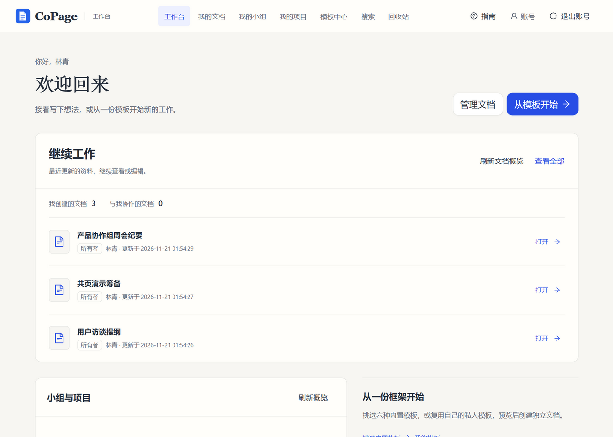
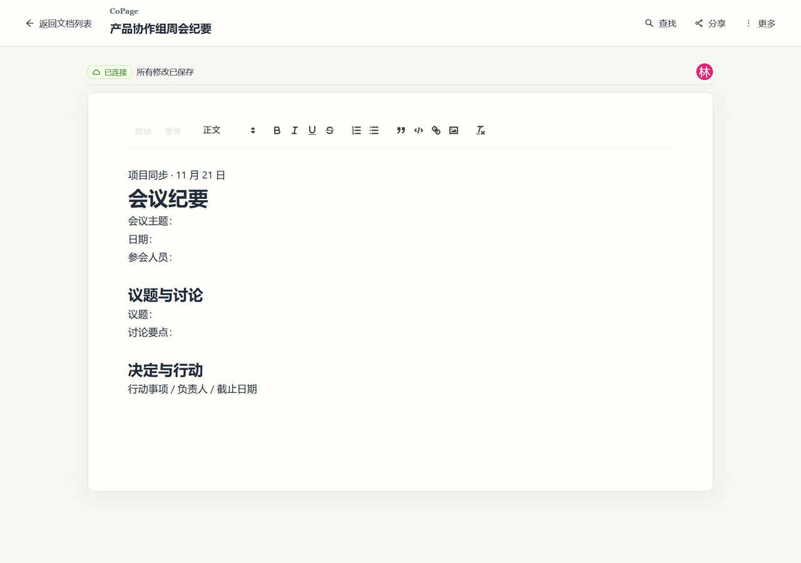
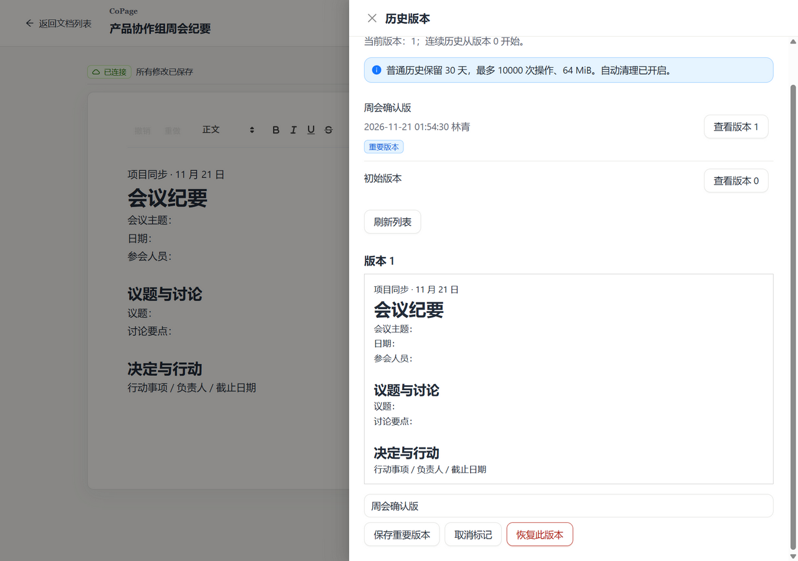
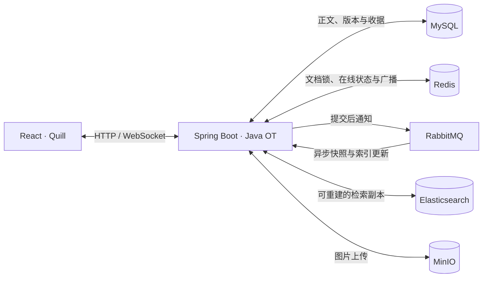

# CoPage 共页

CoPage 是面向课程小组和小型团队的富文本文档工作区。成员可以邀请同伴一起编辑，按小组和项目整理资料，并用搜索、历史版本和回收站找回内容。

[本地运行](#本地运行) · [一次编辑如何保存](#一次编辑如何保存) · [使用与交付文档](#使用与交付文档)



## 可以做什么

- **一起编辑**　查看同伴的在线状态与光标，按文档授予只读或可编辑权限。断线后可追赶已保存的版本，未确认内容保留在当前浏览器。
- **整理资料**　用小组、项目和模板组织文档，按权限搜索标题和正文。支持图片、富文本与纯文本导入导出，以及浏览器打印。
- **找回内容**　预览历史、标记重要版本、恢复误删文档。恢复旧正文会生成新版本，便于继续协作。

| 富文本编辑 | 历史版本 |
| --- | --- |
|  |  |

## 本地运行

需要 JDK 21、Maven 3.9+、Node.js 22.12+ 和 Docker Compose。以下命令在仓库根目录执行，首次启动需要下载依赖。

**Windows** 启动 Docker Desktop，然后双击 [启动CoPage.cmd](启动CoPage.cmd)。两个服务都显示可用后，打开 [http://localhost:5173](http://localhost:5173)。

**分终端启动** 以下后端命令适用于 Bash。手动使用 PowerShell 时按本地使用指南生成密钥。

```sh
docker compose up -d
COPAGE_CONFIG_MODE=local SERVER_ADDRESS=127.0.0.1 JWT_SECRET="$(node -p "require('node:crypto').randomBytes(32).toString('hex')")" mvn -f backend/pom.xml spring-boot:run
npm --prefix frontend ci
npm --prefix frontend run dev
```

打开 [http://localhost:5173](http://localhost:5173) 注册账号并新建文档。邀请另一个账号成为协作者，用独立的浏览器会话打开同一文档可体验双人编辑。常用端口、演示账号和停止步骤见[本地使用指南](docs/本地使用指南.md)。

## 一次编辑如何保存

前端使用 React 18、Vite、Quill 2 和 Ant Design，后端使用 Java 21、Spring Boot 3.5 与 MyBatis/JDBC。浏览器通过 WebSocket 发送编辑，服务端用自研 OT 按已提交版本变换并发操作。MySQL 在同一事务中保存正文、版本、操作日志与幂等收据，事务成功后才确认操作。



Redis 协调多实例的文档锁和增量广播。搜索在 MySQL 中确认权限，再查询 Elasticsearch。历史和文档内容可从 MySQL 恢复，图片由 MinIO 持久化。

## 交付范围

当前提供本地演示及隔离环境的启动、健康检查和备份恢复验证。公网入口与真实服务器演练由负责人后续安排。最终视觉和真实系统中文输入法需要人工确认。知识平台和 AI 功能属于后续规划。

## 使用与交付文档

- [本地使用指南](docs/本地使用指南.md)和[本地交付候选说明](docs/本地交付候选说明.md)
- [接口约定](docs/接口约定.md)、[数据库设计](docs/数据库设计.md)和[历史保留策略](docs/历史版本与保留策略.md)
- [数据库迁移](docs/数据库结构迁移.md)、[部署准备与备份恢复](docs/后端服务器部署.md)
- [开发与验收沿革](docs/开发与验收沿革.md)、[交付验收清单](docs/交付验收清单.md)和[产品交付质量复核](docs/产品交付质量复核.md)。沿革保存原 README 的过程记录，质量复核列出验收边界。
- [Playwright 浏览器冒烟](docs/qa/CODI-124-playwright.md)。在隔离 Compose 环境验证编辑、协作和资料恢复。
